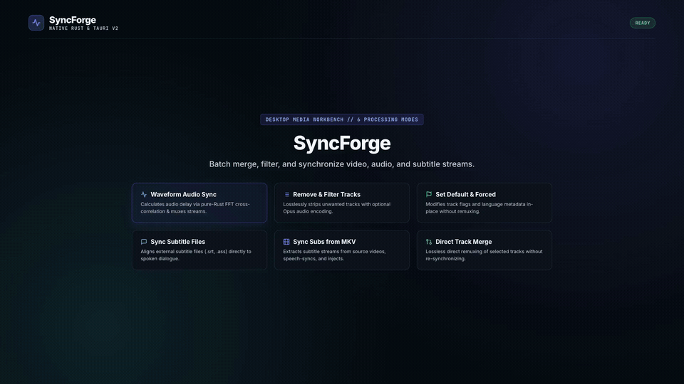

# SyncForge

SyncForge batch-processes video files with MKVToolNix, FFmpeg, and `ffsubsync`,
powered by a native **Rust** backend and **Tauri v2** desktop interface.

<p align="center">
  
</p>

**[3.5.3 — Windows Installer & Automatic Updates](https://github.com/itsmrma/SyncForge/releases/tag/v3.5.3)**
adds separate Windows installer and portable downloads, signed background updates, and a Restart to install action in Settings. See [CHANGELOG.md](CHANGELOG.md).

> [!NOTE]
> **Personal Project & Disclaimer**: SyncForge is a personal project developed for individual media workflows. The pre-compiled executables and release bundles are provided "as is", without any guarantee or warranty of correct functioning, stability, or compatibility with your setup. Use at your own discretion, and always maintain backups of your original media files before modifying them.

## Features

- **Remove & Filter Tracks:** remove unwanted audio/subtitle tracks and optionally convert audio to Opus.
- **Set Default & Forced Flags:** edit MKV metadata in-place without remuxing.
- **Sync Subtitle Files to Audio:** align external subtitle files (.srt, .ass) to video speech/audio using the `ffsubsync` executable.
- **Extract & Sync Subs from MKV:** extract, synchronize, and inject subtitles from another video.
- **Waveform Audio Sync & Merge:** synchronize and merge source audio/subtitles using native Rust FFT waveform analysis.
- **Direct Track Merge (No Sync):** combine selected tracks from two videos or batches of videos (direct lossless remux without sync).
- **Self-Sync Audio & Subtitles (In-Place):** synchronize audio delay, subtitle tracks, or both within an existing standalone video file against reference dialogue/speech in-place, without requiring external video files or secondary muxing.
- **Headless CLI & Script Automation (`syncforge-cli`):** lightweight standalone CLI tool (compiled without WebView/GUI dependencies) supporting all 7 modules via CLI flags or `.json` workflow scripts, plus a built-in **CLI Command** generator in the GUI.
- **Live Tool Detection (Portable Mode):** real-time indicators in Settings (**Settings → Portable Mode & External Tools**) showing whether external CLI tools (`mkvmerge`, `mkvextract`, `mkvpropedit`, `ffmpeg`, `ffsubsync`, `mpv`) are found in `PATH` or the local app directory, with green/red status badges and detected path tooltips.
- **Online Subtitle Search (OpenSubtitles):** find and download missing subtitles directly by title, IMDb/TMDb ID, episode, or exact 64-bit video `moviehash`, and automatically align them to audio speech.
- **AI Agent Automation (MCP Server):** full Model Context Protocol server giving AI agents (Claude Desktop, Cursor, Claude Code, Cline) 100% functional parity with the GUI (see [MCP.md](MCP.md)).

Track dialogs show MKVToolNix IDs, language, codec, names, and flags. The sidebar
collapses to an icon rail, wraps long module titles onto multiple lines for full readability when resized, and prevents text selection during drag gestures. Use **File** or
**Folder** to select each target/source; external subtitles also accept a single
subtitle file. File and folder inputs can be combined. Output remains a folder;
leave it empty to use the target file's parent folder or the target folder.
**Repeat Last** restores files, folders, and the confirmed source ordering, with new files appended for
review. Scroll up to pause terminal following; scroll down or press **Go to end**
to resume. Task results appear in the app and optional desktop notifications.

**Stop task** interrupts analysis and tool processes. Completed mux outputs are
kept and partial output is removed. In-place metadata edits finish their current
write before stopping. Keep backups of media you intend to modify.

## Download and requirements

Download Windows installer/portable editions and standalone Linux and macOS builds from
[GitHub Releases](https://github.com/itsmrma/SyncForge/releases).

On Windows, choose **`SyncForge-Windows-<version>-setup.exe`** for a per-user installation
with automatic updates, or **`SyncForge-Windows-<version>-portable.exe`** to run without
installing. In the installer edition, **Settings → General → Application updates**
controls automatic downloads, checks for updates manually, and shows progress and release
notes. Updates are checked at startup and every four hours. Once a signed update is
downloaded, choose **Restart to install** after media processing finishes; the installer
updates and reopens the app. Settings and external media tools are preserved. Portable,
development, Linux, and macOS builds use manual downloads for now. Existing portable
users need to install the Windows edition once to enable subsequent automatic updates.

See [Windows release setup](docs/windows-updates.md) for signing and release maintenance.

SyncForge interfaces with external CLI tools. You have two convenient options:
1. **Portable Mode (No installation required)**: Simply drop the executables (`mkvmerge`, `mkvextract`, `mkvpropedit`, `ffmpeg`, `ffsubsync`, `mpv` or their folders `tools/`, `bin/`) directly in the same folder as the `SyncForge` executable (or next to `SyncForge.app` on macOS).
2. **System Installation**: Install them via your package manager (`winget`, `choco`, `brew`, `apt`, `pip`) and make them available on `PATH`.

- **MKVToolNix** (`mkvmerge`, `mkvextract`, `mkvpropedit`) — for MKV remuxing, metadata editing, and track extraction.
- **FFmpeg** (`ffmpeg`) — for audio waveform extraction and Opus audio encoding.
- **ffsubsync** (`ffsubsync`) — for speech-to-subtitle synchronization (install via `pip install ffsubsync`, `brew install ffsubsync`, or place the executable in the app folder).
- **mpv** (`mpv`, optional) — for real-time audio and subtitle synchronization auditioning before muxing (`Preview sync with mpv before muxing`).

*(Note: Audio delay cross-correlation in WaveSync Injection is computed natively by SyncForge's built-in Rust FFT engine without external dependencies).*

## Headless CLI & Script Automation (`syncforge-cli`)

SyncForge provides a lightweight, standalone CLI binary (**`syncforge-cli`**) compiled without GUI or WebView dependencies (`--no-default-features`), alongside an integrated **CLI Command** generator inside the desktop GUI.

- **All 7 Modules Supported**: Run `stream_manager`, `set_default`, `sync_subs`, `sync_subs_mkv`, `injection`, `custom_merge`, and `internal_sync` directly from the terminal.
- **Automated & Interactive Modes**: Pass semantic CLI flags (by track ID `1,2` or language code `ita,eng,jpn`) with `-y` (`--yes`) for 100% unattended scripting, or omit flags to use interactive `stdin` prompts.
- **JSON Workflow Scripts**: Execute single tasks or multi-step pipelines with `syncforge-cli script workflow.json`.
- **Diagnostic Subcommands**: Inspect media (`syncforge-cli inspect`), calculate FFT audio delay (`syncforge-cli delay`), preview sync in `mpv` (`syncforge-cli preview`), and verify external tools (`syncforge-cli tools`).
- See **[CLI.md](CLI.md)** for the complete CLI guide, flag reference, and JSON script examples.

## AI Agent Automation & MCP Server

SyncForge includes a native **Model Context Protocol (MCP)** server on stdio (`mcp/index.js`), enabling AI agents in **Claude Desktop**, **Claude Code**, **Cursor**, **Windsurf**, and **Cline** to execute all media operations programmatically.

- **20 Autonomous Tools**: Media inspection, WaveSync waveform delay calculation, external subtitle alignment with `ffsubsync`, `mkvpropedit` metadata flag editing, stream filtering, track merging, Opus conversion, font extraction, episode matching, full batch folder execution, and OpenSubtitles configuration.
- **Online Subtitle Discovery**: Direct OpenSubtitles.com search, video 64-bit `moviehash` calculation, and automated download + alignment.
- **Shared Configuration**: OpenSubtitles API keys entered in GUI Settings (**Settings → Subtitles & Synchronization**) are saved to `~/.config/syncforge/config.json` and automatically loaded by AI agents and MCP tools.
- **Client Setup**: Add to your client's MCP configuration:
  ```json
  {
    "mcpServers": {
      "syncforge": {
        "command": "node",
        "args": ["/ABSOLUTE/PATH/TO/SyncForge/mcp/index.js"]
      }
    }
  }
  ```
- See **[MCP.md](MCP.md)** for full documentation, tool schemas, and prompt templates.

## Run from source

Install [Rust](https://rustup.rs/) and [Node.js](https://nodejs.org/) (v18+), then:

### Desktop Application (Tauri v2)
```sh
git clone https://github.com/itsmrma/SyncForge.git
cd SyncForge/web
npm ci
npm run build
npx tauri dev
```

To build an optimized standalone executable/bundle:
```sh
cd web
npx tauri build
```

### Model Context Protocol (MCP) Server
```sh
# Install MCP dependencies:
cd mcp && npm install && cd ..

# Run MCP server tests:
npm run mcp:test

# Launch MCP server:
npm run mcp
```

## Development

Rust backend code is under `src-tauri/src`, separated into `core`, `features`, and `ui`.
React frontend source is under `web/src`, with separate components, module definitions,
IPC bridge, and theme. MCP server implementation is under `mcp/`.
Rust regression, cancellation, and integration tests are in `src-tauri/tests`; browser
integration tests are in `web/tests`.

See [docs/DEVELOPMENT.md](docs/DEVELOPMENT.md) for structure, test, and build commands.

## Licenses and Third-Party Credits

SyncForge is licensed under the [MIT License](LICENSE).

### Bundled & Embedded Assets
- **Inter Font Family**: Copyright (c) 2016 The Inter Project Authors, licensed under the [SIL Open Font License 1.1](web/public/Inter-LICENSE.txt). Included in builds and distributions.
- **Material Design Icons & MUI**: Copyright (c) Google LLC ([Apache License 2.0](https://www.apache.org/licenses/LICENSE-2.0)) and Material-UI SAS ([MIT License](https://github.com/mui/material-ui/blob/master/LICENSE)).

### External Tools & APIs
- **MKVToolNix** (`mkvmerge`, `mkvextract`, `mkvpropedit`): Copyright (c) Moritz Bunkus, licensed under the [GNU General Public License v2 (GPL-2.0)](https://www.gnu.org/licenses/old-licenses/gpl-2.0.html).
- **FFmpeg** (`ffmpeg`): Copyright (c) FFmpeg developers, licensed under the [GNU LGPL v2.1+ or GPL v2+](https://ffmpeg.org/legal.html) depending on configuration.
- **ffsubsync**: Copyright (c) 2018 Stephen Macke, licensed under the [MIT License](web/public/ffsubsync-LICENSE.txt).
- **OpenSubtitles.com REST API**: Non-commercial community subtitle database for personal use. Requires user-provided Consumer API Key (`OPENSUBTITLES_API_KEY`). Prohibited for commercial exploitation without an enterprise agreement with OpenSubtitles.

